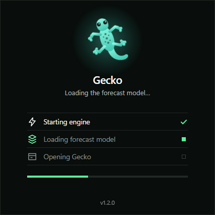
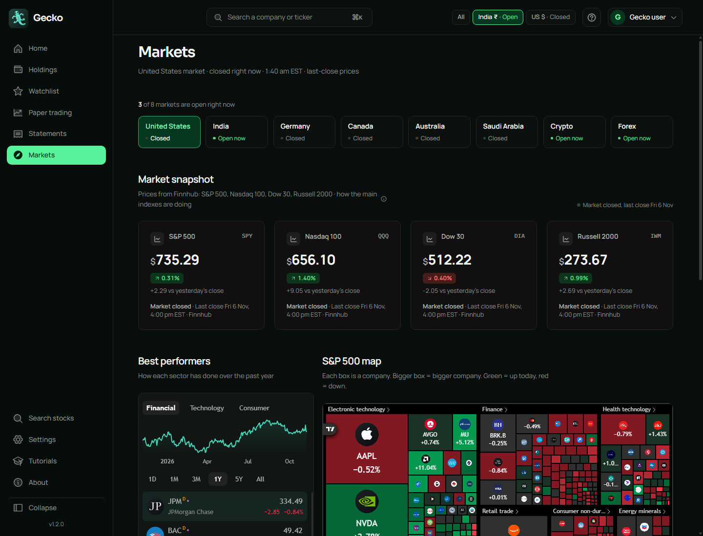
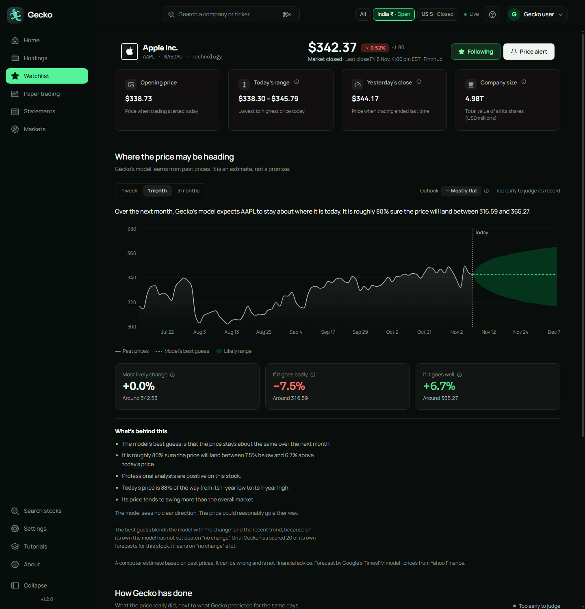
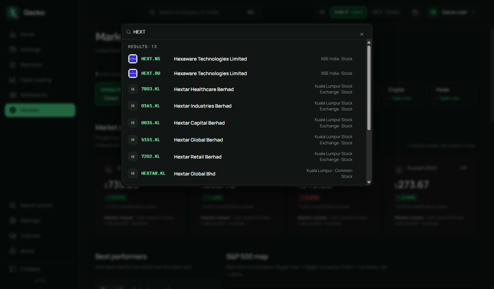
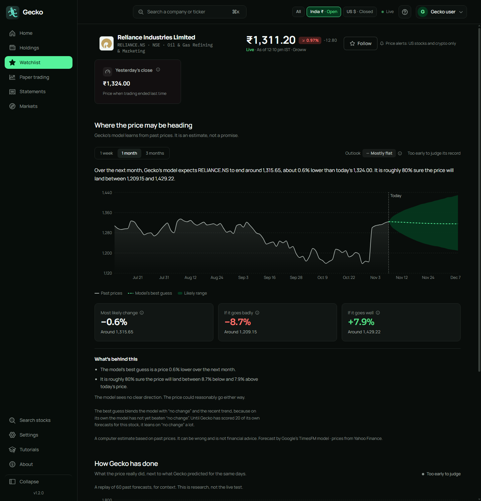

# Gecko

**See where share prices may be heading, in plain words.**
A personal desktop app for Windows: live quotes, your watchlist, and price forecasts from Google's TimesFM model.

[**Download Gecko 1.2.1**](https://github.com/pourabkarchaudhuri/gecko-releases/releases/latest) &nbsp;·&nbsp; Windows 10 / 11, 64-bit

> ## ⚠️ This is an experiment
> Gecko is a personal experiment, shared so others can see and try it. **It is not a finished product, and it should not be recreated or relied on for official, commercial or professional use.**
> Forecasts are computer estimates from past prices. They can be wrong, they are not financial advice, and today they are **no better than guessing "no change"**. Gecko says so on screen. The paper-trading accounts use pretend money. Gecko cannot buy or sell anything.

---

## What you get

**Markets that tell you the truth.** India, the US and six more markets, each marked Live, Delayed, Closed or Stale. When a market is shut, you see the last close and the day it is from, not a blank.

**A forecast you can read.** Past prices, the model's best guess, and a likely range, with the reasoning in plain sentences. It also keeps score of its own forecasts and shows how often it was right.

**Search that finds the company.** Type a name or a ticker for Indian and US stocks, with company logos.

**India and the US, side by side.** Switch between All, India and US in the top bar. Amounts are never mixed across currencies.

**Also inside**
- Your Groww holdings and wallet balances, read-only. Gecko can look, it cannot trade.
- Paper trading with pretend money: watch what simple strategies would have done with real prices, and an Auto Trade switch that carries on by itself every trading day.
- Daily statements you can search and export as a spreadsheet or a PDF.
- Updates inside the app, with a Restart to install button.
- Everything stays on your computer: watchlist, keys (saved encrypted) and forecast history.

---

## Install

**You need:** Windows 10 or 11 (64-bit), about 3 GB of free disk space, and an internet connection for prices. A graphics card is optional.

1. Open the [latest release](https://github.com/pourabkarchaudhuri/gecko-releases/releases/latest) and download **`Gecko-Setup-1.2.1.exe`**.
2. Run it and follow the steps. Gecko installs for your user only, so it does not ask for administrator rights.
3. **Windows may warn you.** The installer is not code-signed yet, so Windows SmartScreen can show "Windows protected your PC". Choose **More info**, then **Run anyway**. Only do this for a file you downloaded from this page.
4. Start **Gecko**. On the first launch it downloads its forecasting model (about 1.3 GB, checked and resumable). The start-up screen shows the progress. This happens once.
5. Click **Get started**. That is all you need to browse markets and see forecasts.

### Optional: add your keys (Settings)
- **Finnhub** (free): live US prices and company details.
- **Groww**: live Indian prices and your holdings, read-only.

Settings has step-by-step instructions for both, and a **Test this key** button. You can skip this and still use Gecko with delayed prices.

### Update
Gecko checks for updates itself. When one is ready, a small indicator appears: download it, then press **Restart to install**. Your data is kept.
Versions before 1.1.0 cannot update themselves: install the newest one by hand once.

### Uninstall
Windows **Settings → Apps → Gecko → Uninstall**. Before you do, you can save everything to one file in Gecko under **Settings → Your data**.

---

## Good to know (version 1.2.1)
- **US paper accounts and US holdings are not built yet.** US shows prices and your watchlist. Your US stocks at Groww sit in a separate US wallet that Groww does not let apps read, so Gecko shows no US holdings. The US switch for Auto Trade stays locked.
- Forecasts are not better than "no change" yet, and Gecko says so.
- The installer is unsigned (see step 3 above).
- Windows only for now.

---

Gecko is built on [OpenStock](https://github.com/Open-Dev-Society/OpenStock) (AGPL-3.0) and uses Google's TimesFM forecasting model, with prices from Groww, Yahoo Finance and Finnhub. Not financial advice.
